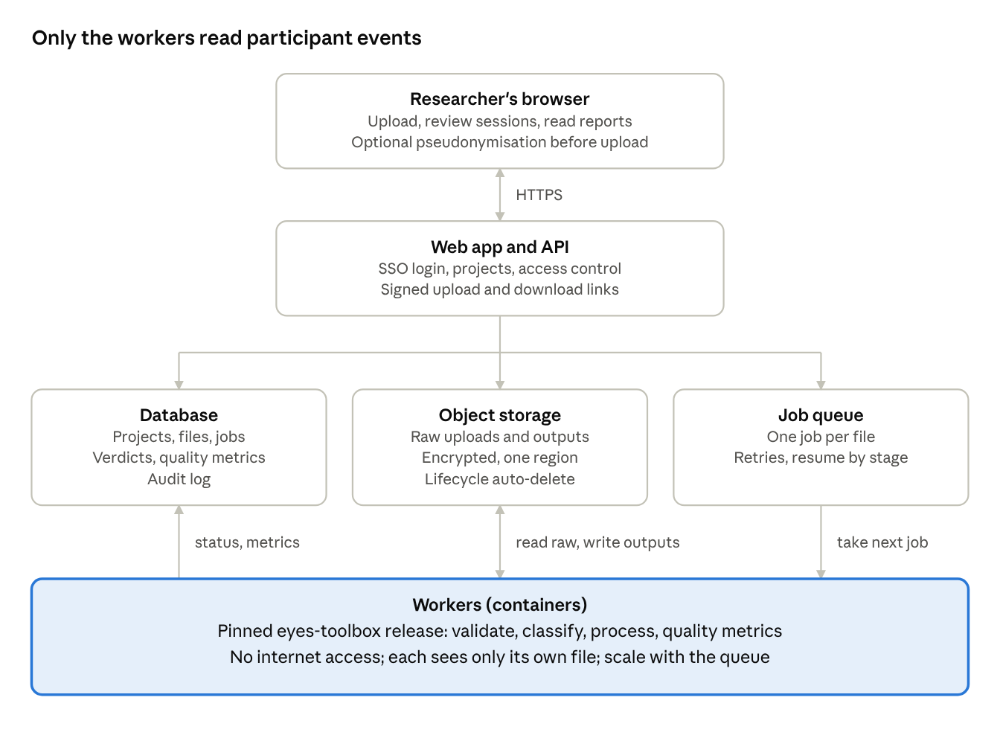
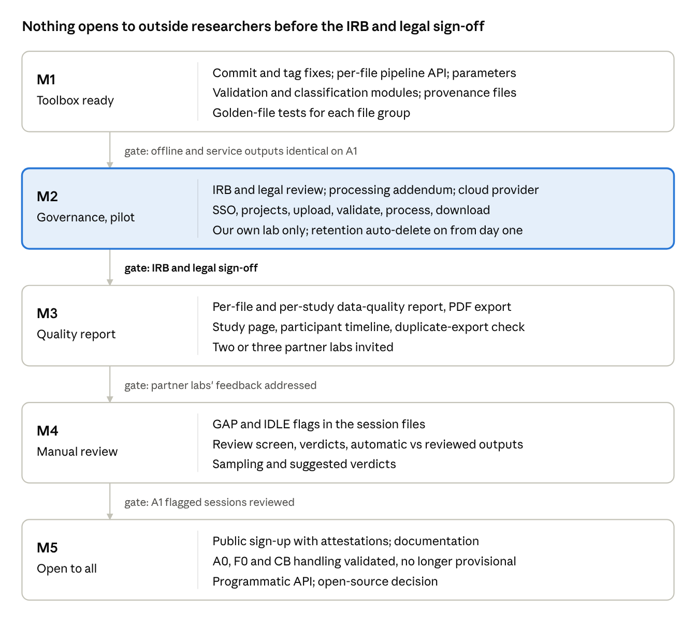

# EYES Online Service: Design

Sep 30, 2026 · Zifei Zhong · draft, to be revised

## 1. Purpose, users and scope

**Purpose.** Chronicle-style Android usage logs are used across exercise science and child-health research as a measure of screen time, but the raw event stream is incomplete: events go missing, power and screen events are unpaired, and the logging vocabulary changes between device types and export versions. The EYES Online Service lets any researcher upload such a log, find out whether it is usable, and get back the EYES reconstruction (device states, app-usage sessions, FAU screen time, pickups) together with a report of how much of that reconstruction is observed and how much is inferred.

**Users.** Any researcher with Chronicle-format data, not only our own group. We assume they are technically comfortable with CSV files but not with Python, and that most will upload whole studies (tens to hundreds of files) rather than single files.

**Principles.**

- *Honest about uncertainty.* Every output says which parts were observed in the log and which were inferred, and by which rule.
- *Reproducible.* Every result is stamped with the toolbox version, parameters and the hash of the input file, so the same input always gives the same output and old results can be re-derived.
- *Same code as the toolbox.* The service runs the eyes-toolbox itself (pinned version), not a re-implementation.
- *Minimal data, short life.* We keep only what is needed, for a fixed period, and then delete it.

**In scope for v1.**

| Capability | What the user gets |
| --- | --- |
| Validate + process + download | Upload a file or zip; validation verdict; per-file processing; download of all outputs as a zip |
| Data-quality report | Per-file and per-study evidence of how reliable the log is and how much was inferred |
| Manual review | A queue of flagged sessions (e.g. overlapping a GAP) with the full event context, and a place to record a verdict |
| Batch / study view | Projects → studies → cohorts, study-level summaries and progress |

**Out of scope for v1.** Live ingestion from Chronicle servers; iOS logs; editing raw events in the browser; cross-study analytics; a public API for programmatic access (planned for later, see milestones).

## 2. Data governance

This is the section that decides whether the service can exist at all. The logs are research data about identifiable participants, many of them children, and we have chosen to host on a commercial cloud and open the service to any researcher. That combination moves us from "a tool our lab runs" to "a data processor for other institutions' human-subjects data". Nothing in sections 3–10 should be built before the points below are reviewed by our IRB and university legal/IT security.

**Our role.** The uploading researcher's institution remains the data controller and holds the IRB approval for their study. We act as a processor: we process only on their instruction, only for the purpose of producing EYES outputs, and never for our own research, product analytics or model training.

**Obligations on the uploader (accepted at project creation, recorded with timestamp and user).**

- Their study has IRB/ethics approval that permits processing by an external service.
- They have a data-use agreement or equivalent that allows it (we provide a standard data processing addendum to sign).
- They upload only the Chronicle export columns we need (section 3) and no direct identifiers (names, emails, phone numbers).
- They confirm the region their data may be stored in.

**Pseudonymisation.** Participant IDs are embedded in file names and in the `participant_id` column. The upload page offers optional client-side pseudonymisation: in the browser, before upload, the participant ID is replaced with a keyed hash and the key never leaves the user's machine. Outputs keep the pseudonym; the user maps it back locally. Columns the toolbox does not use are dropped in the browser too.

**Security baseline.**

- TLS for all traffic; encryption at rest for database and object storage with provider-managed keys (customer-managed keys as an option).
- Single region per deployment, chosen to match the data's jurisdiction (US first; EU deployment if EU researchers join, for GDPR).
- Per-project access control: owner, members, reviewers. No cross-project visibility, including for our own staff, except break-glass access that is logged.
- Workers run without internet access and see only the file they are processing.
- Audit log of every upload, download, view, verdict and deletion, kept longer than the data itself.

**Retention.** Raw uploads and outputs are deleted automatically after a fixed period (proposed default 30 days from upload, project-configurable up to 180 days). Deletion is enforced by object-storage lifecycle rules, not by application code alone, and the user can delete earlier at any time. Review verdicts and aggregate quality metrics (no events, no timestamps) may be kept for the life of the project. Users are warned 7 days before deletion and can download everything before then.

**Children's data.** Many participants are minors. We do not collect anything from participants directly (so COPPA's direct-collection rules do not apply to us), but institutions will treat this as sensitive data and so should we: no participant-level data in logs, emails, error reports or support tickets; error reports reference file IDs only.

## 3. What counts as a valid log file

Validation runs first, on every file, before any processing. It is cheap (one streaming pass), so it runs synchronously for small files and as the first step of the job for large ones. The result is one of three verdicts plus a list of findings, each with a code, a severity and a count.

| Verdict | Meaning | Processed? |
| --- | --- | --- |
| **Rejected** | Not a Chronicle usage log, or unusable | No |
| **Valid with warnings** | Usable, but some outputs are missing or less reliable | Yes, affected outputs marked |
| **Valid** | All checks pass | Yes |

**Level 1: structure (reject on failure).**

- CSV that parses as UTF-8; size within limit (proposed 1 GB per file; largest seen so far is 290 MB).
- Required columns present: `study_id`, `participant_id`, `app_package_name`, `interaction_type`, `event_timestamp`, `timezone`, `application_label`.
- At least 95% of `event_timestamp` values parse; timezone values are valid IANA names.
- A single participant per file.

**Level 2: vocabulary (reject if no app events, otherwise warn).** Every `interaction_type` value is mapped to a canonical event. Both the named form and the "Unknown importance: N" form are accepted, and a file may switch from one to the other partway through (40 of our 394 files do).

| Canonical event | Accepted values |
| --- | --- |
| Resumed | Activity Resumed; Move to Foreground (1) |
| Paused | Activity Paused; Move to Background (2) |
| Stopped | Activity Stopped; Unknown importance: 23 |
| Screen on | Screen Interactive; Unknown importance: 15 |
| Screen off | Screen Non-interactive; Unknown importance: 16 |
| Keyguard shown / hidden | Keyguard Shown / Hidden; Unknown importance: 17 / 18 |
| Shutdown / Startup | Device Shutdown / Startup; Unknown importance: 26 / 27 |
| User unlocked / stopped | User Unlocked / Stopped; Unknown importance: 28 / 29 |
| Known but unused | Unknown importance: 32, 10001, 10002 (counted, ignored) |

A file with no Resumed events at all is rejected. Any value outside this table is reported with its count; if more than 1% of rows are unmapped, the file gets a warning, since it may be a new export version.

**Level 3: content (warnings).**

- No screen events → device states and GLANCE cannot be built.
- No Stopped events → file goes to the "no Stopped" processing group; links cannot be "full".
- No Keyguard Hidden → GLANCE relies on app evidence only.
- Span shorter than 1 day, or more than 50% of the span in GAPs.
- Duplicate rows; out-of-order rows; Resumed events tied to the millisecond with another app's Paused.
- Possible duplicate export: another file in the same study for the same participant whose events overlap by more than 90% (we saw this for two participants in A1). The user chooses which to keep.

**Classification.** A valid file is placed in the decision tree (role → device → logs Stopped) and gets its processing group (A1, A0, F1, F0, CB) and file group (e.g. C-A1). Role comes from the participant ID pattern if the study uses one (configurable per study), otherwise from the user. The classification and its evidence (e.g. "ARC events 12% of rows → Chromebook") are shown on the file page and can be overridden by the user, with the override recorded.

## 4. Processing model

**One job per file.** Each uploaded file gets an immutable file ID (UUID) and a SHA-256 hash. Processing is an asynchronous job keyed by file ID, not by participant key: the current runners pair files by the first two name tokens, which collides when a participant has two exports (the 7213\_C01 case). Jobs are independent, so a study of 400 files runs in parallel across workers.

**Pipeline inside a job.** The same stages as the Makefile, called through a new per-file API instead of directory runners:

1. validate → classify (section 3)
2. sort, deduplicate, reorder
3. device-state blocks: SHUTDOWN, GAP, IDLE, GLANCE (GLANCE uses app evidence)
4. app-usage sessions and chains; GAP/IDLE overlap flags
5. nest → merge app status → FAU screen time; all-events export; pickups; timezone columns
6. quality metrics (section 5) and figures

Each stage writes its outputs and a small status record, so a failed job can resume from the last good stage and the user sees which stage failed.

**Processing group changes behaviour only where it must.** A1 is the reference path. A0/F0 (no Stopped) skip killed-detection and cannot produce "full" links; CB (Chromebook) excludes the ARC home screen from app evidence. Groups whose handling is not yet validated (A0, F0, CB at the time of writing) are processed but their outputs are labelled *provisional* in the UI and in the file headers.

**Parameters.** The thresholds are explicit, versioned and shown in every report:

| Parameter | Default | Used for |
| --- | --- | --- |
| GAP threshold | 3 h | No events for this long → GAP block |
| Link window | 1 s | App handover counted as a link |
| Same-app switch | 1 s | Paused→Resumed of same app is one period |
| Screen-off grace | 5 s | App paused shortly after screen off |
| Kill window | 5 s | Stopped soon after Resumed is not a kill |
| GLANCE app evidence | 5 s | Non-system foreground time that counts as use |

In v1 users cannot change them; they are fixed per toolbox release so results are comparable across studies. A later version may allow per-project overrides, recorded with the result.

**Versioning and reproducibility.** Every output file carries a header block (or sidecar JSON) with: toolbox version (git tag + commit), parameter set ID, input file hash, processing group, and job timestamp. When a new toolbox version is released, existing results are not changed silently; the study page shows "results from v1.2, v1.3 available" and the user can reprocess. Old and new results can be compared side by side for a transition period.

**Limits.** Per-file size 1 GB, per-study 400 files per upload (more in several uploads), per-user concurrent jobs capped to keep costs predictable. A typical A1 file takes under a minute; the largest seen, a few minutes.

## 5. Outputs and the data-quality report

**Downloads.** Per file, a zip with the same outputs the toolbox produces today, so existing analysis scripts keep working: reordered log, `_BLOCKS.csv`, `_SESSION.csv`, `_SESSION_APPS.csv`, FAU usage, all-events, pickups (with timezone columns), figures, plus `quality.json` and `provenance.json`. Per study, a zip of all files plus study-level summary tables.

**Data-quality report.** The core of the service's value: it shows how unreliable the raw log is and how much of the reconstruction rests on inference. It is organised in the three layers of evidence we used for A1, so the same argument can be made to any data owner.

**A. How unreliable is the raw log?**

- Duplicate and out-of-order rows.
- App exits without a Paused (share of app periods ended by the next app's Resumed instead).
- App switches without the Stopped of the previous app.
- Screen on without a matching off, and vice versa; shutdown/startup count mismatch.
- Share of the recording span in GAPs (≥ 3 h without any event).
- Millisecond ties between one app's Resumed and another's Paused.

**B. How much is observed vs inferred?**

- Share of sessions whose end is observed (Paused or killed) vs inferred (screen off, shutdown, end of log).
- Share of sessions fully observed (observed end and every link shows the full pattern), by count and by hours.
- Link types: full / paused\_resumed / resumed\_only / stopped\_resumed.

**C. Do the two independent timelines agree?** App sessions are built only from app events; device states only from screen, keyguard and power events. Their agreement is evidence neither is badly wrong.

- Share of ACTIVE time that contains an app session.
- Session hours falling in IDLE, GAP, SHUTDOWN, GLANCE (these are the disagreements, and the flagged sessions in section 6).

Each metric is shown with the study distribution (median and range across files) so a user can see at a glance which files are outliers. For reference, the A1 numbers: 99.7% of sessions have an observed end and 75% of links show the full pattern, but 355 sessions spanning a silence of 3 h or more hold 54% of session hours. The report must show both figures side by side; the first alone would be misleading.

**Formats.** An HTML page per file and per study in the app, a PDF export of the same for sharing with a data owner, and the metrics as CSV/JSON. Every report states the toolbox version and parameters.

## 6. Manual review

Some sessions cannot be judged by rule. Rather than silently truncating or keeping them, the service flags them and puts them in front of a person, with everything needed to decide.

**What gets flagged (v1).**

| Flag | Rule | A1 scale |
| --- | --- | --- |
| `overlaps_gap` | Session spans a silence ≥ GAP threshold | 355 sessions, 54% of session hours |
| `in_idle` | ≥ X% of the session falls in IDLE (screen off) | 12% (parents) / 26% (children) of session hours |
| `end_inferred_long` | End inferred and session ≥ N hours | tbd |

The flags are also columns in `_SESSION.csv` (`longest_silence_s`, `overlaps_gap`, `gap_s`, `idle_s`), so users who do not review can still filter.

**Review screen.** One flagged session at a time:

- A timeline of the session with device-state blocks underneath (ACTIVE, IDLE, GAP, GLANCE, SHUTDOWN) and the silence highlighted.
- The full chain of apps with link types and end evidence.
- The raw events for the session plus a context window before and after (default 10 minutes), with the rule that each event triggered.
- App category where known (e.g. navigation, media, PiP-capable), since a Maps session during IDLE is plausible and a game is not.

**Verdicts.** Keep as is / truncate at the silence / truncate at a chosen event / exclude / unsure, with an optional note. Verdicts are stored per session with reviewer and time, keyed by (file hash, session start, toolbox version) so they survive reprocessing when the session is unchanged and are re-queued if it changes.

**Applying verdicts.** Outputs are produced in two forms: *automatic* (rules only) and *reviewed* (automatic plus verdicts). Both are downloadable and the report shows the difference, so the effect of human judgement is itself visible.

**Scaling review.** Reviewing 355 sessions by hand is feasible for one study but not for every user. Two aids: sampling (review a random 10% and extrapolate with a confidence interval), and suggested verdicts from simple rules (e.g. a navigation app during IDLE → keep), always shown as suggestions.

**Two reviewers.** Optional per project: each flagged session is reviewed twice, disagreements go to the owner, and agreement rate is reported.

## 7. Batch and study view

**Hierarchy.** Project (access control, retention, attestations) → Study (a data collection, e.g. the EYES cohort) → Wave/cohort (e.g. A1, A6, A12) → File. Participants are a view across files, not a level, so a participant with several exports or several waves is shown together.

**Upload.** Drag a zip or a folder. Validation runs on each file as it arrives; the page shows a live table with verdict, classification and job status per file. The user can exclude files (e.g. the older of two duplicate exports) before processing starts.

**Study page.**

- Counts by verdict, file group (P-A1, C-A1, ...) and job status; failed jobs with the stage that failed and a retry button.
- The decision-tree breakdown of the study, like the file-catalog page we built for our own data.
- Quality metrics across files: distributions and an outlier list.
- Review queue progress: flagged, reviewed, remaining, by reviewer.
- Totals: recorded days, FAU hours, sessions, pickups, by group and role.
- Toolbox version of the results and whether a newer one is available.

**Participant page.** All files for the participant, their spans on one timeline (overlaps show duplicate exports), and per-day FAU and pickups.

**Downloads.** Whole study (zip of per-file outputs plus summary tables), or a filtered subset (e.g. only C-A1, only reviewed outputs).

## 8. Architecture

A conventional web service with one unusual constraint: participant events are read only by the workers, which have no internet access and run a pinned toolbox release. The web app and API handle identity, projects and metadata; files move between the browser and object storage through short-lived signed links, so they never pass through the API servers.

| Component | Proposed choice | Notes |
| --- | --- | --- |
| Front end | React single-page app | Timeline and review views need interactive charts |
| API | Python (FastAPI) | Same language as the toolbox; shares validation code for fast checks |
| Identity | University SSO via CILogon, fallback email + MFA | Any researcher, but tied to an institution |
| Database | Managed Postgres | Metadata, verdicts, metrics, audit log; no raw events |
| Object storage | S3 or GCS bucket per region | Encryption at rest, versioning off, lifecycle rule for retention |
| Queue | Managed queue (SQS / Pub/Sub) | Jobs carry file ID and toolbox version only |
| Workers | Containers on a managed batch service (AWS Batch / Cloud Run jobs) | Memory sized from the largest file; scale to zero when idle |
| Monitoring | Provider logging with PII scrubbing | Logs reference file IDs, never events or participant IDs |

**Cost shape.** Storage is small (our 394 files are 5.7 GB raw) and short-lived; compute is per job and scales to zero. The fixed cost is the database, the web tier and staff time for support and security review, not the processing.

## 9. Changes needed in eyes-toolbox

The service is a thin layer over the toolbox, so most of the real work is here, and all of it also benefits our own offline processing.

1. **Commit and tag the current fixes** (nest, merge, pickups, GLANCE, sessions, manual). They are uncommitted on `main` today. Tag the first service release as v1.0.
2. **Per-file API.** `eyeslib.pipeline.process(input_path, out_dir, params, group) -> Result` running all stages for one file, with no directory globbing and no pairing by participant key. The Makefile runners become loops over this function, so offline and online results are identical.
3. **Validation module.** `eyeslib.validate.validate(path) -> Report` implementing section 3, including the vocabulary table as data (one YAML file), so a new export version is a data change, not a code change.
4. **Classification module.** The decision tree as code, returning group plus evidence; replaces the ad-hoc logic in `tools/file_catalog`.
5. **Parameters object.** One frozen dataclass holding every threshold in section 4, passed down instead of module constants; its hash is the parameter set ID.
6. **Provenance.** Each output gets `provenance.json` (version, commit, params ID, input hash, group).
7. **Session flags.** `longest_silence_s`, `overlaps_gap`, `gap_s`, `idle_s` in `_SESSION.csv` (the design proposed after the A1 analysis).
8. **Quality metrics as a library.** Move `tools/evidence_stats.py` into `eyeslib.quality`, per file, returning a dict; study aggregation separate.
9. **Group-specific handling.** A0/F0 (no Stopped), CB (Chromebook), PiP apps as secondary periods. Until validated, outputs are marked provisional.
10. **Tests.** Golden-file tests on a small anonymised set covering each file group and the old/new vocabulary switch; the randomised brute-force tests for nest/merge/pickups kept in CI.
11. **Resource bounds.** Streaming reads for validation; peak memory measured on the largest file so worker sizes can be set.

## 10. Milestones

M1 needs no decisions from anyone else and improves our own processing, so it can start now. M2 is the long pole: the IRB and legal review sets the pace for everything after it, so it should be started in parallel with M1. No dates are set yet; they depend on who builds this and on how long the review takes.

## 11. Open decisions

| # | Decision | Options | Needed by |
| --- | --- | --- | --- |
| 1 | IRB and legal review of hosting others' participant data | Our IRB determination; university counsel on processor role and DPA template | Before M2 |
| 2 | Cloud provider | AWS or GCP (whichever the university has an agreement and BAA/DPA with) | M2 |
| 3 | Retention period | 30 days default (proposed) vs 90; maximum 180 | M2 |
| 4 | Identity | University SSO (InCommon/eduGAIN via CILogon) vs email + MFA | M2 |
| 5 | Who pays | Lab grant, free tier with quotas, or institution-paid projects | M3 |
| 6 | Supported export versions | Only Chronicle exports we have seen, or a documented mapping for others | M3 |
| 7 | Pseudonymisation | Optional (proposed) vs mandatory in the browser | M2 |
| 8 | Review flags thresholds | IDLE share X% and long-inferred N hours in section 6 | M4 |
| 9 | Open source | Publish toolbox and service code (helps trust and reproducibility) or not | M5 |
